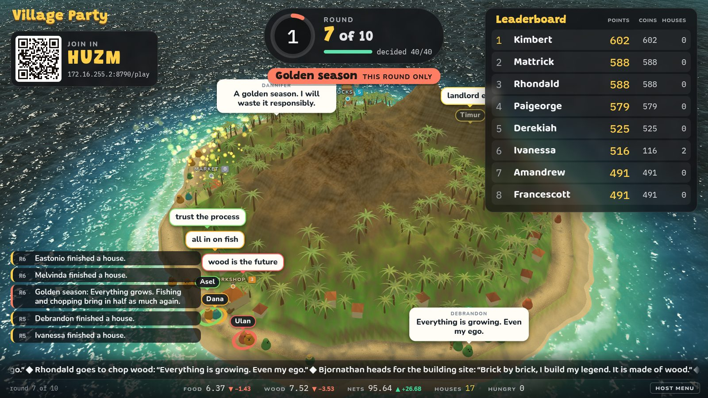
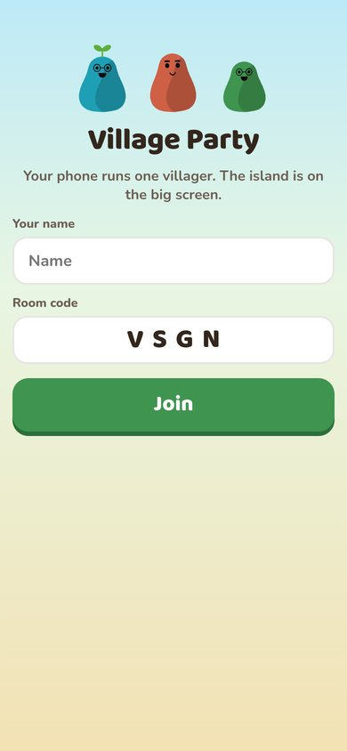
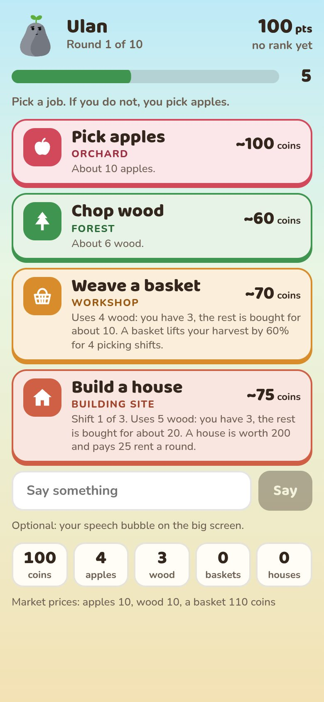
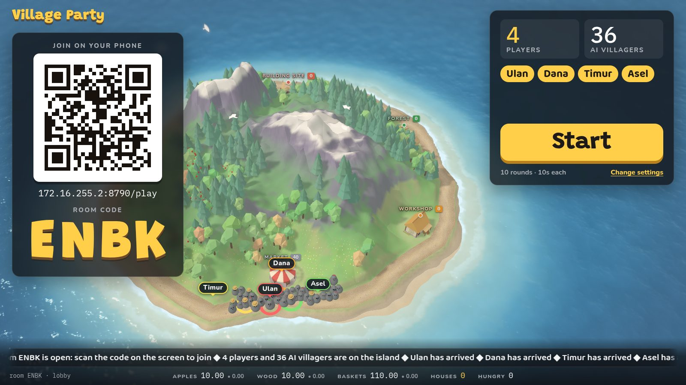
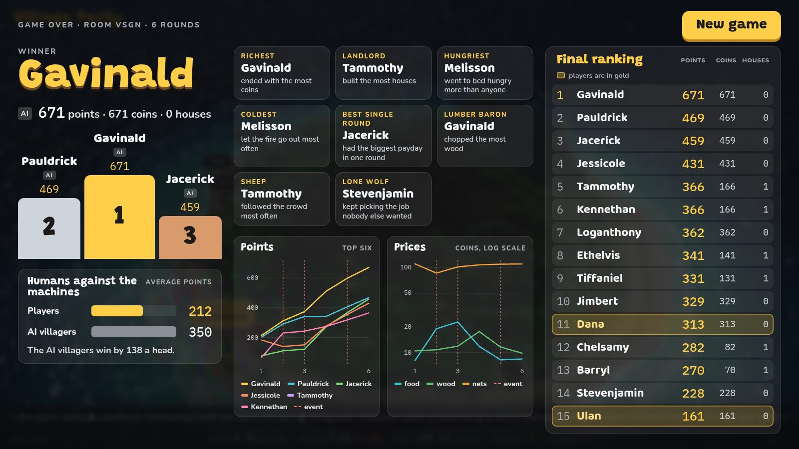
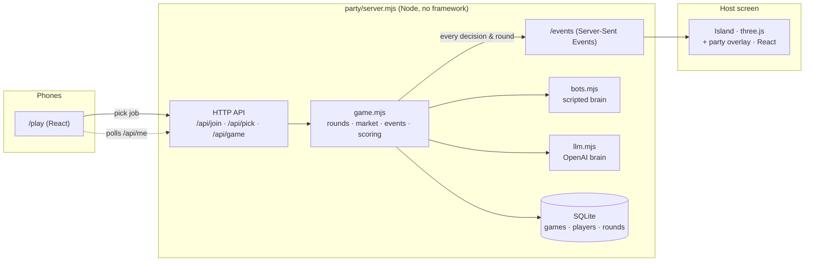

<div align="center">

# 🏝️ Village Party

**A party game where your phone is a villager, the big screen is a living island, and the economy pushes back.**

Scan a code, pick a job each round, and try to out-earn your friends *and* a village of AI
villagers who all have their own strategies, personalities and opinions about you.

`Real-time multiplayer` · `AI agents` · `Live market economy` · `Built at Eurasian Hack London with Devin`



</div>

---

## Why it's fun

Most "economy" games have fixed prices. In Village Party, **the price of everything is set by what
everyone else just did.** If the whole room goes fishing, fish is worth nothing. If nobody chops
wood, the one person who did gets rich. Every round is a quick guess about what the other 20+
people in the room (and the AI villagers) are about to do. Then a seagull heist wipes out your
food anyway.

- **No app to install.** Phones join by QR code or a 4-letter room code in the browser.
- **Easy to learn, hard to play well.** Four buttons, a 12-second timer, and an estimate of what each job pays.
- **The village is never empty.** AI villagers fill it up to 60, so you can play with 2 people or 40.
- **Chaos on demand.** Storms, forest fires, cold snaps, a surprise wealth tax. The host can set one off whenever they like.
- **A proper ending.** Podium, awards ("Sheep", "Lone wolf", "Hungriest"), price charts, and the big question: *did the humans beat the machines?*

<table>
<tr>
<td width="33%"></td>
<td width="33%"></td>
<td width="33%" valign="top">

**On your phone**

1. Scan the QR on the big screen
2. Type your name and you're on the island
3. Each round, pick **Fish**, **Chop wood**, **Craft a net** or **Build a house**
4. Each job shows its estimated pay at last round's prices
5. Add a one-liner for your speech bubble on the big screen (optional)

</td>
</tr>
</table>

---

## How a round works

```
PICK    →  every villager (human or AI) picks one job before the clock runs out
WORK    →  catch fish, chop wood, craft a net (+60% catch for 4 shifts) or put a shift into a house
SELL    →  everything beyond what you keep goes to the mainland trader:
           the more of a good the village offers, the lower its price this round
LIVE    →  everyone eats 2 food and burns 1 wood, buying what's short;
           go hungry or cold and you work at 60% strength next round
EARN    →  a finished house is worth 200 points and pays 25 rent every round after
SCORE   →  points = coins + houses. Richest villager at the end wins.
```

The round ends early once everyone has picked, so a room that decides quickly plays quickly.

**Events** (chaos level from *Calm* to *Mayhem*): 🌊 Storm · 🐟 Fish frenzy · 🔥 Forest fire · ❄️ Cold
snap · 🦠 Blight · 🐦 Seagull heist · 💸 Surprise tax · 🌾 Golden season.



---

## The AI villagers

Every non-human villager gets a **strategy** and a **personality**, and they really play the game:

| Strategy | Plays like |
|---|---|
| `planner` | does the sums and takes whatever pays best right now |
| `contrarian` | does whatever the fewest villagers did last round |
| `trend` | chases whatever the most villagers did last round |
| `landlord` | builds houses as early as possible and lives off the rent |
| `specialist` | sticks to the job they're talented at, whatever the price |
| `netmaker` | crafts nets to sell, and fishes with one in between |
| `copycat` | copies whatever the current leader did last round |
| `gambler` | picks on a whim |

Personalities (greedy, lazy, paranoid, dreamer, gossip, philosopher, dramatic, competitive) shape
both their choices and what they say: *"They laughed at my nets. They are not laughing now. They
are hungry."*

**Two brains:**

- **Scripted** (default, free, no network): fast heuristics plus a large hand-written line bank that reacts to events, hunger and other players by name.
- **LLM** (`party/llm.mjs`, OpenAI): one structured-output request decides for 12 villagers at once, each in their own voice, and writes a short village-newspaper recap at the end. A round can never stall: anyone the model hasn't answered for in time falls back to the scripted brain, and spending is capped per game (`PARTY_AI_BUDGET_USD`, default $0.50). The server supports it (`brain: "openai"` on `/api/game` when `OPENAI_API_KEY` is set); the host-screen toggle is still marked *coming soon*.



---

## Quick start

Needs **Node 22+** (the server uses the built-in `node:sqlite`).

```bash
npm run web:install && npm run web:build   # build the front end once
npm start                                  # host screen on http://localhost:8787
```

Open `http://localhost:8787` on the big screen (laptop + projector/TV), press **Create game**, and
have everyone scan the QR. Phones land on `/play`.

**Phones on a different network?** Run `ngrok http 8787` next to it: the server finds the tunnel
by itself and puts its URL in the QR. Or set `PUBLIC_URL=https://your.host npm start`.

**Optional LLM villagers:** put `OPENAI_API_KEY=...` in `.env` (see `.env.example`).

| Host setting | Range |
|---|---|
| AI villagers | 0 to 40 (village capped at 60 with players) |
| Rounds | 5 to 30 |
| Seconds per round | 6 to 30 |
| Chaos | Calm · Mild · Spicy · Mayhem |

During a game, **Host menu** (bottom right) lets you trigger any event or end the game early.
People who join after the start take over an AI villager ("Dana has taken over Barryl's body").

### Fill a screen without people

```bash
node party/demo.mjs --bots 14 --humans 4 --rounds 30 --seconds 8 --chaos 3
```

Creates a game, joins four fake phone players and plays it, so the host screen has something live.

---

## Under the hood



- **One process, no external services.** A plain `node:http` server holds the live game in memory, streams every decision and round to the host screen over SSE, and writes finished games to SQLite (`party/data/party.db`) for the "past games" list.
- **The market:** each round, a good's price moves toward `PRICE0 × (reference / village supply)^0.6`, clamped to 0.4×–2.5× and smoothed, so crowding into one job is punished but prices never go wild.
- **Balanced by simulation, not by feel.** `party/sim.mjs` plays hundreds of whole games instantly on a fake clock, with fixed-strategy villagers added, to check that no single job always wins:

  ```bash
  npm run sim            # node party/sim.mjs [games=200] [bots=20] [rounds=12] [chaos=2]
  ```

  | Always plays… | Avg points (200 games) |
  |---|---|
  | the best-paying job (greedy) | 639 |
  | build houses | 593 |
  | chop wood | 584 |
  | contrarian (fish vs wood) | 521 |
  | fish | 461 |
  | random | 363 |
  | nets | 314 |

  No pure strategy wins. Playing the market wins.

- **Tested:** `npm test` runs the game engine and the server API (`party/*.test.mjs`, Node's built-in test runner).

### Layout

```
party/
  server.mjs     HTTP + SSE server, room codes, join tokens, SQLite
  game.mjs       the game: jobs, the market, events, eating, houses, scoring, awards
  bots.mjs       scripted villagers: 8 strategies × 8 personalities, line bank
  llm.mjs        OpenAI villagers + end-of-game newspaper recap, budget-capped
  sim.mjs        balance harness (whole games on a fake clock)
  demo.mjs       fake players for a live demo
  *.test.mjs     tests
web/
  src/party/     host overlay: setup, lobby + QR, running game, results
  src/play/      the phone controller
  src/island/    the 3D island (three.js)
backend/, chain/ Settlers of Solana, the earlier engine this grew out of (see below)
```

---

## Built with AI

Village Party was built in one day at **Eurasian Hack London**, working alongside AI agents
(Cognition's **Devin**).

- **Where it helped:** standing up the dev environment, writing and iterating the game loop and the balance harness, building the host overlay and phone UI, writing tests, and producing this README and its screenshots (Devin ran a full game in a headless browser to capture them).
- **What worked best:** giving the agent a way to check itself. `party/sim.mjs` and `npm test` let changes to the economy be judged by numbers instead of vibes.
- **Where it struggled:** game balance needed a human eye for what's *fun*, not just what's fair, and the LLM villagers needed hard guarantees (timeouts, scripted fallback, budget cap) so a slow model can never freeze a room full of people.

---

## Where it came from

The engine underneath started as **Settlers of Solana** (`backend/` + `chain/`), an earlier
research sim where 100 LLM agents run a free-market economy whose every trade, loan and
foreclosure settles on a Solana program. Village Party takes that idea (a village of agents
in a market where prices are set by everyone's choices) and turns it into something a room full
of people can play together in ten minutes. The 3D island and villager names come from that project.

The original README, with setup for the Solana sim, is in [`docs/SETTLERS.md`](docs/SETTLERS.md).
